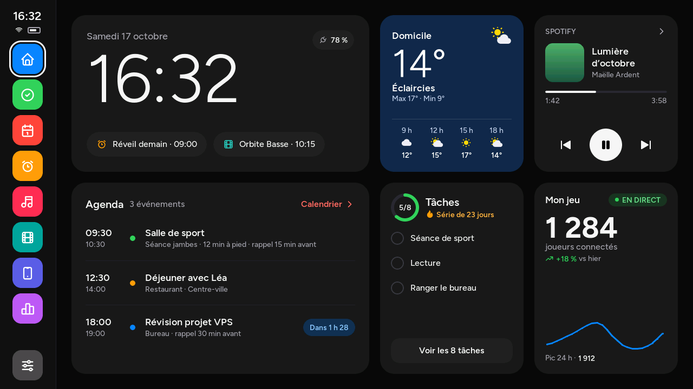
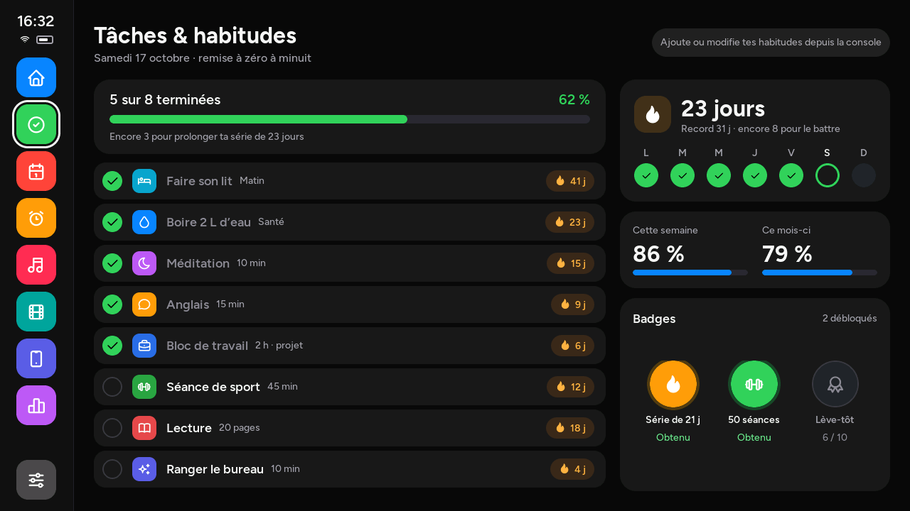
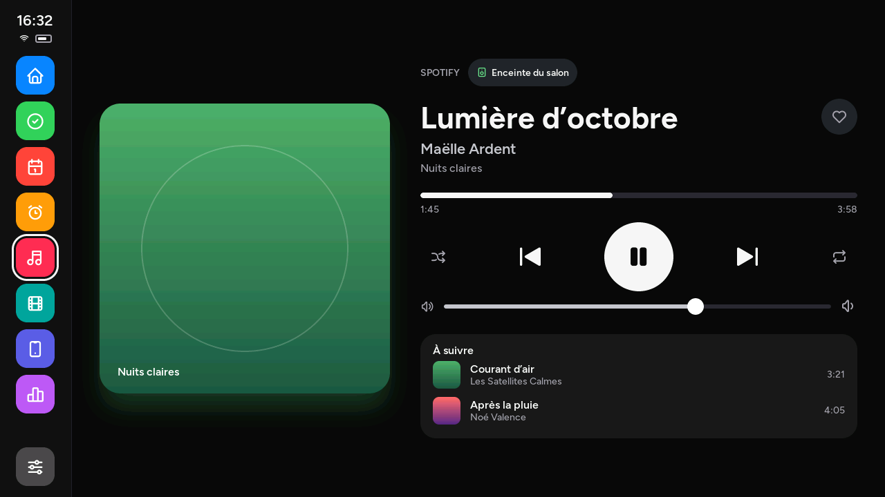
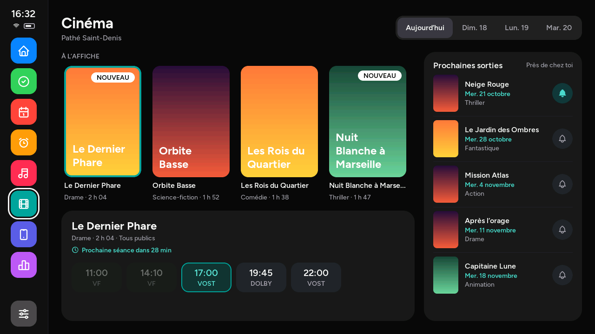
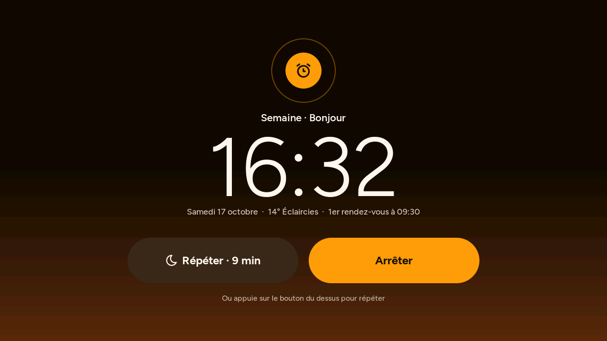
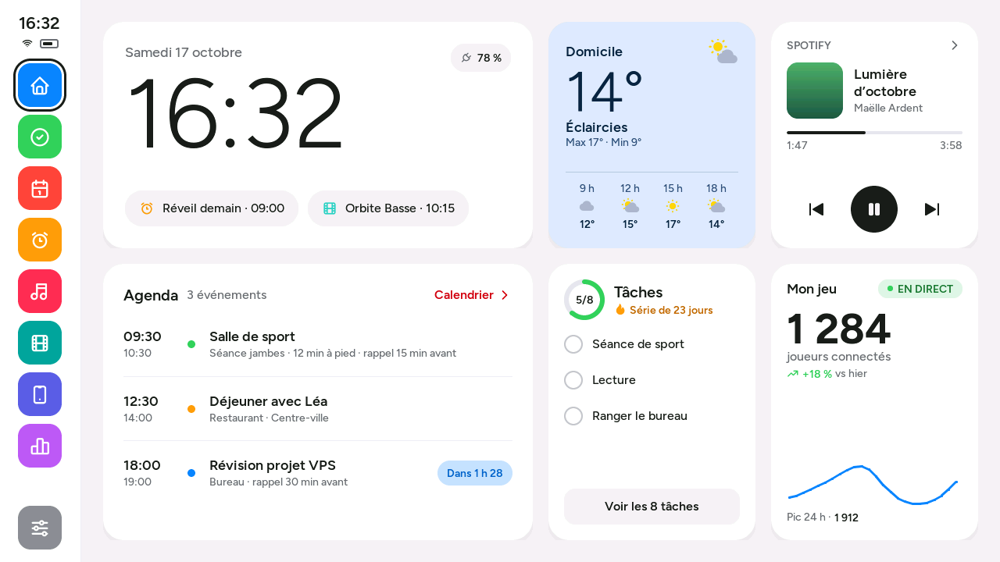
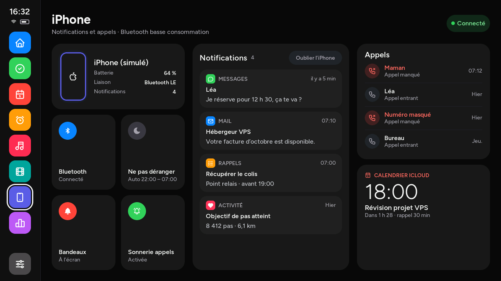
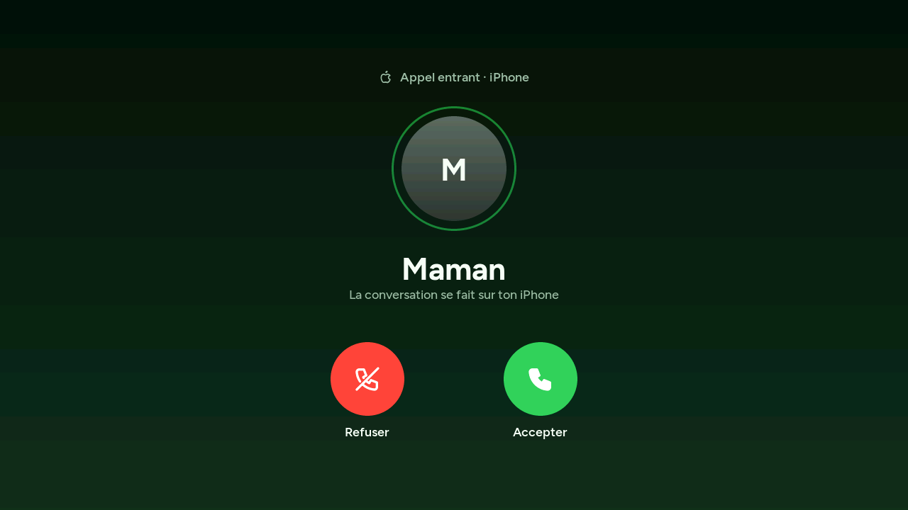

# Smart Personal Dashboard

Tableau de bord de chevet pour la **M5Stack Tab5** (écran 5″ 1280×720, ESP32-P4),
inspiré d'iOS et d'Apple CarPlay, avec un **serveur sur ton VPS** et une
**console web** pour tout gérer à distance (clés d'API, habitudes, réveils, réglages
de l'écran).

| Écran (émulateur) | Ce qu'il affiche |
|---|---|
| Accueil | heure, météo, Spotify, agenda du jour, tâches, joueurs Roblox en direct |
| Tâches & habitudes | cases à cocher, séries 🔥, jokers, badges, taux de la semaine et du mois |
| Calendrier | semaine iCloud, mini-mois, événements du jour avec rappels |
| Réveil | alarmes, répétition, routine matinale, sonnerie même après une veille profonde |
| Musique | lecture Spotify en cours, pochette, commandes, volume, file d'attente |
| Cinéma | films Pathé à l'affiche près de chez toi (affiches, séances par jour) et sorties à venir |
| iPhone | notifications et appels de ton iPhone en Bluetooth (accepter / refuser), bandeaux, ne pas déranger |
| Statistiques | graphiques de régularité, sport, statistiques du jeu Roblox |
| Verrouillage | code PIN, widgets discrets |
| Réglages | thème sombre/clair/auto, luminosité, mode nuit, veille, Wi-Fi, appairage |

Captures de l'émulateur (données d'exemple) — toutes dans [docs/captures](docs/captures) :

| | |
|---|---|
|  |  |
|  |  |
|  |  |
|  |  |

## Architecture

```
┌──────────────┐  HTTPS (jeton)   ┌──────────────────────────────┐   ┌───────────────┐
│ Tab5 / émul. │ ───────────────► │ VPS : Nginx → Node.js :8787  │──►│ Spotify, Pathé│
│ LVGL 9 (C++) │  /api/v1/…       │  API Fastify + SQLite        │   │ Roblox, iCloud│
└──────────────┘                  │  console web (React)         │   │ Open-Meteo    │
                    navigateur ─► │  /api/… (session + 2FA)      │   └───────────────┘
                                  └──────────────────────────────┘
```

- La **tablette ne parle qu'à ton serveur** : les clés d'API restent sur le VPS
  (chiffrées en AES-256-GCM dans la base SQLite) et ne sont jamais envoyées à l'écran.
- Le serveur interroge les services, prépare un état prêt à afficher
  (`GET /api/v1/state`) et redimensionne les images en JPEG lisible par la tablette.
- La tablette garde le dernier état reçu : elle reste utilisable hors ligne
  (heure, réveils, dernière météo…).

## Dossiers

| Dossier | Contenu |
|---|---|
| `server/` | API Node.js + TypeScript (Fastify, SQLite, intégrations), tests |
| `web/` | console web React + Vite (compilée et servie par l'API) |
| `firmware/app/` | interface LVGL commune à l'émulateur et à la tablette |
| `firmware/platforms/desktop/` | émulateur PC (SDL2 + libcurl) |
| `firmware/platforms/tab5/` | firmware ESP-IDF de la Tab5 (BSP M5Stack, Wi-Fi par l'ESP32-C6) |
| `deploy/` | installation sur le VPS (script, service systemd, site Nginx) |
| `docs/` | guides détaillés et contrat de l'API |

## Démarrage rapide

1. **Mettre le serveur en ligne sur le VPS** → [docs/DEPLOIEMENT.md](docs/DEPLOIEMENT.md)
   (une commande depuis Windows : `deploy\envoyer-sur-vps.ps1`).
2. **Brancher les services** (Spotify, Roblox, Pathé, iCloud, météo) dans la console
   → [docs/INTEGRATIONS.md](docs/INTEGRATIONS.md).
3. **Essayer l'écran sur ton PC** en attendant la tablette → [docs/EMULATEUR.md](docs/EMULATEUR.md)
   (`./smart_dashboard_sim --demo` pour les données d'exemple, ou appairé à ton serveur).
4. **Quand tu reçois la Tab5** : compiler et flasher → [docs/FIRMWARE.md](docs/FIRMWARE.md).

Développement en local (serveur + console avec rechargement automatique) :

```bash
cd server && npm install && npm run dev        # API sur http://localhost:8787
cd web && npm install && npm run dev           # console sur http://localhost:5173
cd server && npm test                          # tests de l'API
```

En local, laisse `NODE_ENV` vide dans `server/.env` (sinon le cookie de session
exige HTTPS).

## Documentation

- [docs/DEPLOIEMENT.md](docs/DEPLOIEMENT.md) — VPS : Nginx existant, HTTPS, service, mises à jour, sauvegardes
- [docs/INTEGRATIONS.md](docs/INTEGRATIONS.md) — créer l'app Spotify, ID Roblox, cinéma Pathé, mot de passe iCloud
- [docs/EMULATEUR.md](docs/EMULATEUR.md) — lancer l'écran sur Windows (WSL2) ou Linux
- [docs/FIRMWARE.md](docs/FIRMWARE.md) — compiler et flasher la Tab5 avec ESP-IDF
- [docs/API.md](docs/API.md) — contrat complet de l'API (console et tablette)
